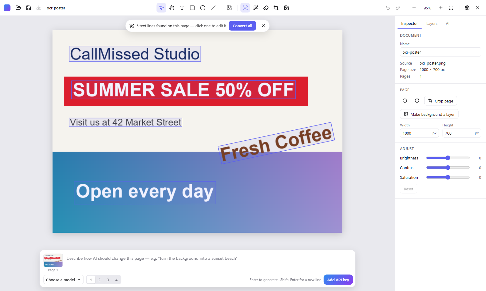
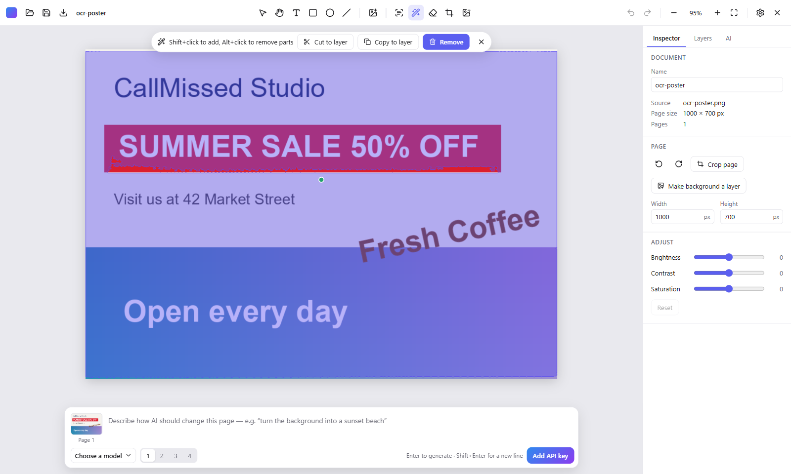
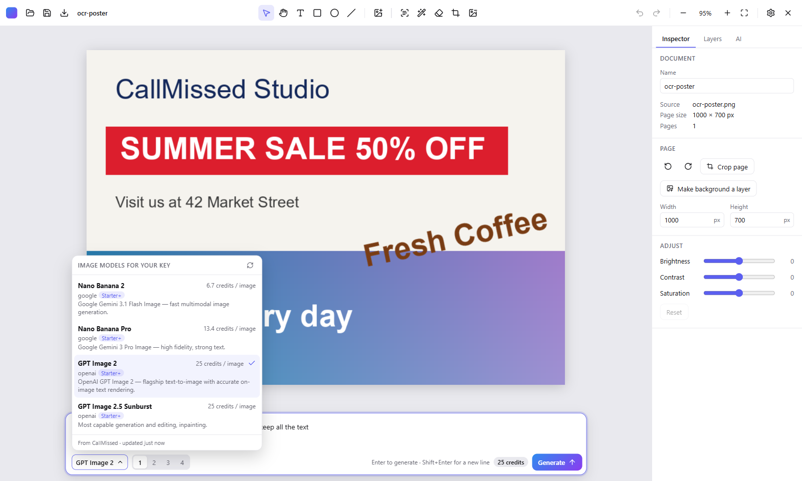

# CallMissed Studio

Open-source (MIT) desktop editor for images and PDFs that understands what is in them. It detects text and objects **locally** so you can retype text, move or remove objects, erase things and strip backgrounds. Then it can send the edited page plus a prompt to the CallMissed image API (your own key) for AI image-to-image generation, with full history.



## Download

**[Download the latest Windows installer](https://github.com/DurveshN/callmissed-studio/releases/latest)** (`CallMissed-Studio-Setup-<version>-x64.exe`).

- Windows 10 or 11, 64-bit. 8 GB RAM or more recommended for background removal.
- Installs for your user only (no administrator rights needed), in a folder you choose.
- **The installer is not code-signed yet.** Windows SmartScreen may show "Windows protected your PC": choose **More info → Run anyway**. Signing is planned before version 1.0.
- On first start the app offers to download its AI models (about 600 MB in total; you can pick which). Each download is checked against a pinned SHA-256 checksum.
- Uninstalling keeps your projects, models and API key; delete `%APPDATA%\CallMissed Studio` to remove them too.

This is a beta (0.9). Please report problems on the [issues page](https://github.com/DurveshN/callmissed-studio/issues).

## What it does

- **Detect Text** (`D`): finds every line of text in a picture or PDF page and turns it into editable text in a matching font, size, colour and angle, erasing the original.
- **Magic Select** (`W`): click any object to select it, then cut it to its own layer, copy it, or remove it (the gap is filled in).
- **Eraser** (`B`), **Remove background**, **Crop** (`C`), rotate, resize, and brightness / contrast / saturation.
- **Text boxes** (`T`): click to add text or drag to draw a box; the bar above it changes font, size, colour, bold, italic and alignment.
- **Layers**: text, shapes, lines and pictures; choose which picture is the page background.
- **Pages**: insert the pages of other PDFs or pictures anywhere, add blank pages, duplicate, reorder, rotate or delete pages, and export all pages or a range as a real PDF (see below).
- **AI generation**: describe a change and get new versions of the page from CallMissed models.
- Export to PNG, JPEG, WebP or PDF; save projects as `.cmsp` files with full undo history.



## Privacy

Text detection, object selection, erasing and background removal run on your PC with ONNX Runtime (GPU through DirectML when available). Nothing leaves your computer unless you use AI generation, which sends the page and your prompt to CallMissed with your key.

## Editing PDFs

- **Detect Text on a PDF page** reads the page's own text: exact words, fonts and positions, with no recognition needed. Scanned pages, and pictures inside pages, are recognized with OCR instead.
- **Pages tab**: insert PDFs or pictures (each PDF page, or each picture, becomes a page), add blank pages, duplicate pages, drag to reorder, and rotate or delete from a page's ⋯ menu. Inserted PDF pages stay vector, like the original's.
- **Export → PDF** writes every page, the current page, or a range such as `1-3, 5` (to split or extract pages). Pages you did not change are copied as they are, so their vectors and text stay intact. Your edits are drawn on top as real text, using embedded fonts. You can optionally make scanned pages searchable.
- **Known limitation:** the original text inside a PDF page is not edited in place. Replaced text is erased visually and new text is placed over it. By default, the export writes such edited pages as images ("Remove replaced text"), so the old text is really gone. If you turn that option off, edited pages stay as vectors, but the replaced text remains in the file under the edit, where it can still be selected and searched.

## AI generation (CallMissed)

Add your CallMissed API key under Settings → CallMissed. The key is stored encrypted on your PC and only sent to CallMissed. The models your key can use, with their prices and plans, are read from CallMissed and kept until the key changes.

Describe a change in the bar under the canvas. The page, with all your edits, is sent as the reference picture, and the cost in credits is shown before you generate. Results stay with the project in the AI tab, where you can compare them with the page, use one as the page, add it as a layer, or export it. The Usage view shows what the app has spent and lets you import images from your CallMissed account.



## Building from source

Requirements: Windows 10/11 x64, Node.js ≥ 22.12.

```sh
npm install
npm run dev        # run the app with hot reload
npm run typecheck
npm run lint
npm test           # unit tests (Vitest)
npm run test:e2e   # builds, then runs Playwright against the Electron app
npm run dist       # builds the installer into release/<version>/
```

See [RELEASING.md](RELEASING.md) for publishing a version.

## Architecture (short)

- `src/main`: Electron main process (files, database, secrets, network, model downloads, PDF writing)
- `src/preload`: typed, minimal `window.studio` bridge
- `src/renderer`: React UI, sandboxed, no Node access
- `src/shared`: IPC contracts (zod) and shared types
- `src/ml`: ONNX Runtime worker process (OCR, SAM 2.1, LaMa, BiRefNet)

Design: [spec](docs/superpowers/specs/2026-10-11-callmissed-studio-design.md), [research notes](.research/00-summary.md), [CONTEXT.md](CONTEXT.md).

## License

MIT. See [LICENSE](LICENSE). Third-party software, fonts and models are listed in [THIRD_PARTY_LICENSES.md](THIRD_PARTY_LICENSES.md).
